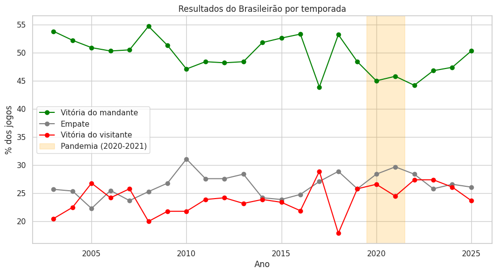
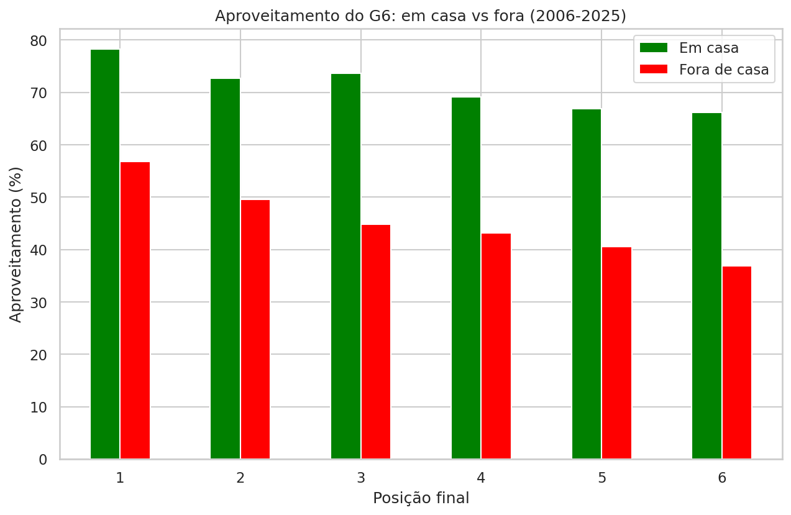

# Vantagem de jogar em casa e perfil dos campeões no Brasileirão (2003-2025)

Análise exploratória de 23 temporadas do Campeonato Brasileiro de pontos
corridos para responder: quanto vale jogar em casa, como isso mudou ao
longo do tempo e o que os campeões têm em comum.

## Principais resultados

- A vitória do mandante caiu de ~52% (2003-2009) para ~47% (2022-2025).
- A queda vem dos dois lados: mandantes pontuam menos e visitantes pontuam mais.
- A pandemia não mostra efeito próprio: com a torcida de volta, o nível
  continuou baixo.
- Campeões têm aproveitamento médio de 67,5%.
- Entre o 1º e o 6º colocado, a diferença de aproveitamento é de 12 pontos
  percentuais em casa e 20 fora: o desempenho como visitante é o que mais
  separa o campeão.

## Dados

Fonte: [Campeonato Brasileiro de Futebol (Kaggle)](https://www.kaggle.com/datasets/adaoduque/campeonato-brasileiro-de-futebol).
Arquivo utilizado: `campeonato-brasileiro-full.csv`.
Os dados não estão no repositório; baixe-os pelo link acima.

## Metodologia

- Resultado calculado a partir dos placares (não da coluna `vencedor`).
- Temporada de 2020 corrigida (terminou em 2021).
- Padronização de nomes de clubes (Gremio Prudente = Barueri).
- Aproveitamento = pontos conquistados / pontos possíveis, para comparar
  formatos de campeonato diferentes.
- Comparação entre períodos com margem de erro de 95%.

## Limitações

- Faltou 1 jogo em 2016 (Chapecoense x Atlético-MG, não disputado após a
  tragédia do avião).
- Amostras pequenas de campeões por período: resultados ilustrativos.
- A correlação entre aproveitamento e posição é em parte matemática,
  pois a posição é definida pelos pontos.
- A análise descreve o que mudou, mas não prova por quê.

## Próximos passos

Teste estatístico formal da queda, uso dos dados de gols, cartões e
estatísticas, e modelo preditivo de resultados.

## Como reproduzir

1. Baixe o dataset pelo link da seção *Dados* e coloque o arquivo
   `campeonato-brasileiro-full.csv` na mesma pasta do notebook.
2. Instale as dependências: `pip install -r requirements.txt`
3. Abra `brasileirao_analise.ipynb` (Jupyter ou Google Colab) e execute
   todas as células.
